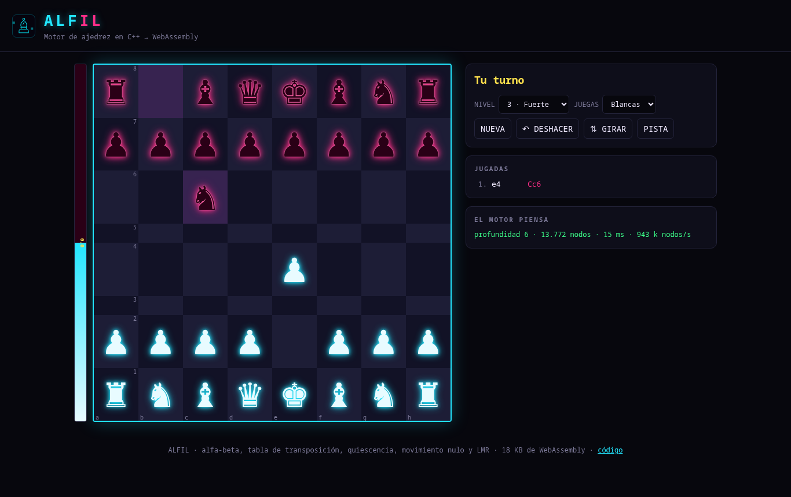

<div align="center">



### Motor de ajedrez en C++. El mismo código juega en la terminal (UCI) y en el navegador (WebAssembly).

<a href="https://neckhurtttt.github.io/Alfil/"></a>




</div>

## ♟️ Qué tiene

| Parte | Cómo |
|---|---|
| Tablero | 64 casillas, piezas con signo (+ blancas, − negras), Zobrist para la clave |
| Jugadas | generación pseudo-legal + filtro de jaque; enroque, al paso y coronación |
| Búsqueda | alfa-beta **negamax** con **profundización iterativa** y ventana nula (PVS) |
| Poda | **movimiento nulo**, **LMR** (reducción de jugadas tardías), extensión por jaque |
| Orden | jugada de la tabla primero, capturas MVV-LVA, **killers** e **historial** |
| Memoria | **tabla de transposición** de 262 144 entradas |
| Táctica | **quiescencia** con capturas para no cortar en medio de un cambio |
| Evaluación | material + tablas por casilla, rey distinto en el final, pareja de alfiles, peones doblados y pasados |
| Tablas | ahogado, 50 jugadas, triple repetición y material insuficiente |

En la web: 4 niveles, jugar con negras, deshacer, **pista**, barra de evaluación y notación en español (C, A, T, D, R).

## ✅ Pruebas perft

`perft` cuenta todas las posiciones a cierta profundidad; si un solo movimiento especial está mal, el número no da.

| Posición | Profundidad | Esperado | Alfil |
|---|---|---|---|
| Inicial | 5 | 4 865 609 | ✓ |
| Kiwipete | 3 | 97 862 | ✓ |
| Posición 3 (finales) | 5 | 674 624 | ✓ |
| Posición 4 (coronaciones) | 4 | 422 333 | ✓ |

```sh
g++ -O2 -o alfil motor/alfil.cpp
./alfil perft 5                     # 4865609
./alfil perft 3 "r3k2r/p1ppqpb1/bn2pnp1/3PN3/1p2P3/2N2Q1p/PPPBBPPP/R3K2R w KQkq - 0 1"
```

## 🖥️ En la terminal (UCI)

Funciona con cualquier interfaz UCI (Cute Chess, Arena, En Croissant):

```
uci
position startpos moves e2e4
go movetime 1000
bestmove …          ← la jugada que elige
```

## 🌐 En el navegador

`compilar.sh` lo compila a WebAssembly **sin Emscripten**, solo con `clang --target=wasm32` y `wasm-ld`. El motor corre en un **Web Worker** para que la página no se congele mientras piensa (≈ 1 millón de nodos por segundo).

```sh
./compilar.sh && cd web && python3 -m http.server 8000
```

<div align="center"><sub>ALFIL · hecho por <a href="https://github.com/NeckHurtttt">NeckHurtttt</a></sub></div>
